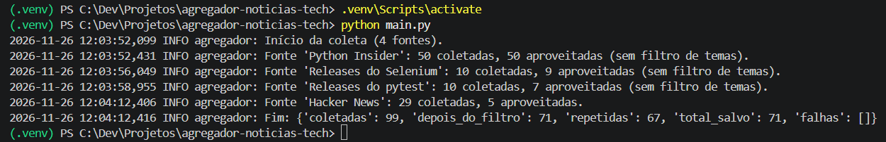
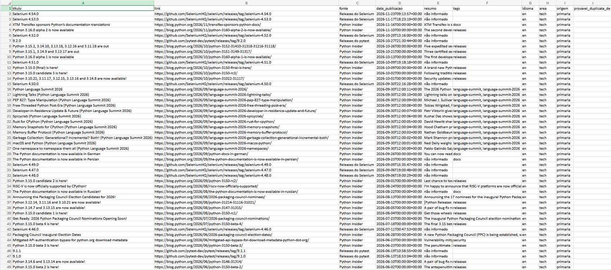
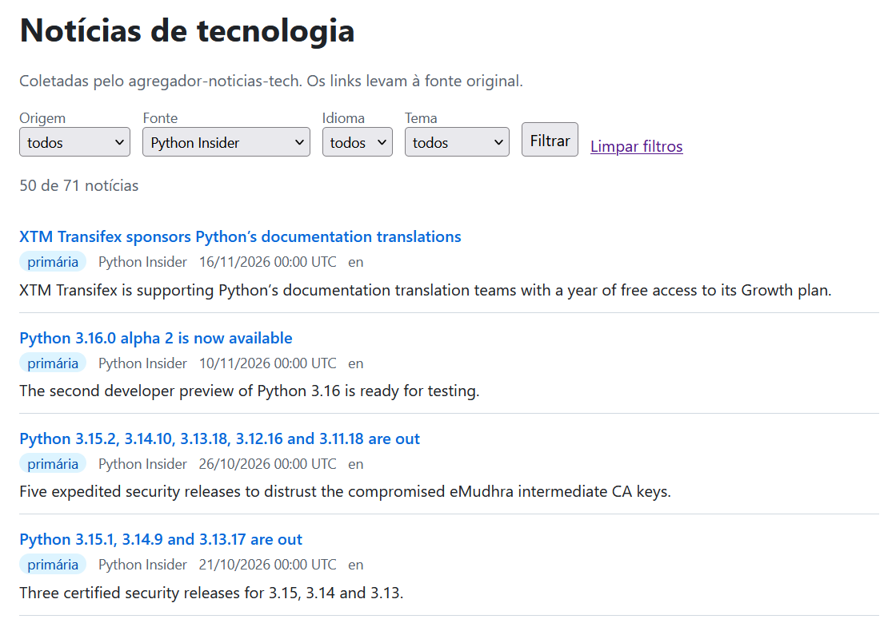

# agregador-noticias-tech

[](https://github.com/DevSchoof/agregador-noticias-tech/actions/workflows/testes.yml)

Agregador de notícias de tecnologia em Python. Lê feeds RSS/Atom e a API oficial
do Hacker News, filtra por tema, remove repetidas e salva o resultado em JSON e
CSV. Dá prioridade à **fonte primária** (blogs oficiais e releases) e usa
fontes de comunidade como complemento.

Projeto de portfólio, feito para mostrar de forma verificável: código aberto,
**testes automatizados com pytest** e uma arquitetura em que **várias fontes**
se ligam a um núcleo comum. Uma página simples em Flask mostra as notícias
coletadas e é testada de ponta a ponta com **Selenium** (padrão Page Object,
Chrome e Firefox em modo headless, no GitHub Actions).

## Como rodar

Requer Python 3.11 ou mais novo.

```bash
python -m venv .venv
# Windows:      .venv\Scripts\activate
# Linux/macOS:  source .venv/bin/activate
pip install -r requirements.txt

python main.py      # coleta e salva em dados/noticias.json e dados/noticias.csv
python -m web.app   # página com as notícias em http://127.0.0.1:5000
pytest              # testes rápidos (não acessam a internet nem abrem navegador)
pytest -m e2e       # testes E2E com Selenium (precisa do Chrome e/ou Firefox)
```

Cada execução junta o que já estava salvo com o que foi coletado, sem repetir
notícias. O log fica em `logs/agregador.log`.

### Exemplo real

Uma execução em 26/11/2026: das 99 notícias coletadas, 71 ficaram depois dos
filtros (nightly e pré-versões descartadas nas releases; só os temas no Hacker
News), e 67 já estavam salvas de execuções anteriores.



O CSV aberto no Excel (primárias primeiro, da mais nova para a mais antiga;
releases do GitHub não têm resumo, porque o feed só traz as notas completas):



## Fontes

| Fonte | Como é lida | Origem | Filtro de temas |
|---|---|---|---|
| Python Insider (blog oficial do Python) | feed RSS | primária | não (já é do tema) |
| Releases do Selenium no GitHub | feed Atom | primária | não; descarta nightly e pré-versões |
| Releases do pytest no GitHub | feed Atom | primária | não; descarta nightly e pré-versões |
| Hacker News | API oficial (até 30 itens) | comunidade | sim |

As fontes ficam em [`config/fontes.py`](config/fontes.py), e os temas
(Python, automação, dados e IA, em português e inglês) em
[`config/temas.py`](config/temas.py).

Antes de incluir uma fonte, foram verificados o feed oficial e os termos de uso.
Dois veículos brasileiros ficaram de fora porque os termos proíbem coleta
automatizada ou reprodução sem autorização.

## Como funciona

```
config/fontes.py ──► cada fonte coleta ──► filtro de temas ──► deduplicação ──► JSON + CSV
                     (RSS/Atom ou API)     (se a fonte pedir)   (com o que já
                                                                 estava salvo)
```

```
core/        núcleo: não conhece nenhuma fonte, nem faz acesso à rede
  modelo.py         a dataclass Noticia (o contrato de dados) e suas validações
  normalizacao.py   limpa HTML, corta o resumo, normaliza link, data e texto
  filtro.py         casa a notícia com os temas; detecta pré-versões
  deduplicador.py   remove repetidas e ordena
  exportador.py     grava e lê JSON e CSV
fontes/      cada fonte implementa coletar() -> list[Noticia]
  base.py           interface comum e o download (User-Agent, timeout)
  rss_generico.py   qualquer feed RSS ou Atom
  hacker_news.py    API oficial do Hacker News
main.py      orquestra tudo; cada fonte roda isolada num try/except
web/         página Flask que lê o JSON salvo
  app.py            rotas, cabeçalhos de segurança e formatação
  filtros.py        lógica pura dos filtros (sem Flask)
tests/e2e/   testes de ponta a ponta com Selenium
  paginas.py        Page Object da página de notícias
  conftest.py       servidor em thread, navegadores e evidências na falha
```

Cada fonte separa a **parte de rede** (baixar) da **parte pura** (converter a
resposta em `Noticia`). A parte pura é testada com dados fictícios, sem internet.

### Deduplicação

1. **Mesmo link:** os links são comparados normalizados (domínio em minúsculas,
   sem `utm_*` e outros parâmetros de rastreio, sem `#fragmento`, sem barra
   final). Se o mesmo link vier de uma fonte primária e de uma de comunidade,
   fica a primária.
2. **Mesmo título, links diferentes:** as duas ficam, e a secundária é marcada
   no campo `provavel_duplicata_de` com o link da principal.

Na saída, as primárias vêm primeiro; dentro de cada grupo, da mais nova para a
mais antiga.

### Formato de cada notícia

`titulo, link, fonte, data_publicacao, resumo, tags, idioma, area, origem, provavel_duplicata_de`

- Campo ausente fica como `"não informado"`. Notícia sem link é recusada.
- `data_publicacao` em ISO 8601, no fuso UTC.
- `tags` é lista no JSON e texto separado por vírgula no CSV.
- O JSON é UTF-8; o CSV é `utf-8-sig`, para o Excel abrir os acentos certos.

## Regras respeitadas

**Direitos autorais.** Notícia é conteúdo de terceiros. São salvos só título,
link para o original, fonte, data, tags e um resumo curto que a própria fonte
publica no feed (até ~300 caracteres, sem HTML). O texto completo nunca é baixado
nem salvo, e a página da matéria nunca é aberta. Exemplo: quando um item só traz
o conteúdo completo (`<content>`), o resumo fica como "não informado". No Hacker
News, o autor e o texto dos posts não são salvos.

**Comportamento com as fontes.** `User-Agent` que identifica o projeto, timeout
em toda requisição, pausa entre fontes e entre itens do Hacker News, e nenhuma
nova tentativa após erro (um `429 Too Many Requests` não é repetido). Só feeds e
APIs oficiais; nada de raspar HTML de sites de notícias.

**Robustez.** Se uma fonte falha, o erro vai para o log e as outras continuam.
A gravação é feita num arquivo temporário e só então troca o definitivo, para
uma queda no meio não corromper o histórico. Se o JSON salvo estiver corrompido,
a execução para sem sobrescrevê-lo.

## Segurança

Os dados vêm de terceiros, então são tratados como não confiáveis:

- **Links:** só são aceitos `http` e `https` com domínio. Links `javascript:` ou
  `data:` são descartados, porque executariam código se o link virasse um
  `<a href>` numa página.
- **CSV:** um valor que começa com `=`, `+`, `-`, `@`, tab ou quebra de linha
  recebe um `'` na frente, para o Excel não executá-lo como fórmula (*CSV
  injection*). O JSON guarda o texto original.
- **XML:** foi verificado manualmente que um feed com entidade externa (XXE)
  não consegue ler arquivos locais (ainda não há teste automatizado para isso).
- **Parte pura sem rede:** o feed é passado ao `feedparser` como bytes, para
  ele nunca baixar uma URL por conta própria.

## Página e testes E2E

`python -m web.app` abre uma página que lê `dados/noticias.json` e lista as
notícias: título com link para o original, origem, fonte, data, idioma, resumo e
aviso de provável duplicata. Há filtros por **origem, fonte, idioma e tema**,
num formulário sem JavaScript: os filtros vão na URL (`/?origem=comunidade&tema=ia`),
então um filtro pode ser compartilhado por link. O tema é calculado na hora com
as palavras-chave de `config/temas.py`.

A página existe para os testes com Selenium; não é um site para publicar. Ela
roda só neste computador (`127.0.0.1`), com o modo debug do Flask desligado.

A página com os dados reais, filtrada por fonte (Python Insider, 50 de 71 notícias):



**Segurança da página.** Os textos vêm de terceiros:

- O Jinja escapa o HTML: um título com `<script>` aparece como texto.
- A `Content-Security-Policy` proíbe qualquer script e só permite o CSS do
  próprio site, uma segunda camada caso o escape falhasse.
- Links externos abrem em nova aba com `rel="noopener noreferrer"`.
- Valores desconhecidos nos filtros da URL são ignorados, sem erro.
- JSON corrompido gera erro 500 com mensagem simples; os detalhes vão só para o log.

**Como os testes E2E funcionam** ([`tests/e2e/`](tests/e2e/)):

- Uma fixture sobe a página numa *thread*, numa **porta livre escolhida pelo
  sistema**, lendo um JSON **fictício**. A página e os dados são locais.
- O Chrome e o Firefox abrem em modo **headless**; cada teste roda nos dois.
  Para escolher: `E2E_NAVEGADORES=chrome pytest -m e2e`.
- **Page Object:** a classe `PaginaNoticias` sabe *como* operar a página
  (`filtrar(origem="comunidade")`, `titulos()`, `limpar_filtros()`...); os
  testes só dizem *o que* verificar. Se o HTML mudar, só a classe muda.
- Os elementos são achados por atributos `data-testid`, que não mudam com o visual.
- **Esperas explícitas** (`WebDriverWait`), nunca `time.sleep`. Depois de
  filtrar, o teste espera a página antiga sumir antes de ler a nova.
- **Evidência na falha:** se um teste E2E falha, o print e o HTML da página são
  salvos em `evidencias_e2e/`. No GitHub Actions, ficam para baixar como
  *artifact* da execução.
- Os testes não clicam nos links externos, para não acessar a internet; conferem
  o endereço e os atributos.

Para conferir que os testes pegam defeitos de verdade, a marcação da opção
selecionada foi removida de propósito do template: os 2 testes que verificam
isso falharam, com print e HTML salvos.

## Testes

**299 testes rápidos** e **17 testes E2E** (34 execuções: Chrome e Firefox),
com pytest. **Nenhum acessa a internet**:

- Os feeds e as respostas da API são **fixtures fictícias** escritas à mão.
- A parte de rede é testada com uma "sessão falsa" no lugar do `requests`.
- O `main` é testado com fontes falsas (uma que falha, uma que funciona, duas
  execuções seguidas).
- Regra do projeto: todo bug encontrado vira primeiro um teste que o reproduz.

- A página é testada sem navegador com o *test client* do Flask, e de ponta a
  ponta com Selenium (seção anterior).

Cobrem: modelo e validações, normalização, filtro de temas e de pré-versões,
deduplicação, exportação, conversão de cada fonte, orquestração, página,
filtros da página e fluxo no navegador.

O [GitHub Actions](.github/workflows/testes.yml), a cada push no `main` e em
pull requests:

- roda os testes rápidos no Python 3.11 e 3.12;
- roda os testes E2E no Chrome e no Firefox;
- procura vulnerabilidades conhecidas nas dependências com o `pip-audit`.

## Limitações

- **O filtro olha palavras, não sentido.** "Gemini" casa com IA mesmo quando o
  texto fala da constelação. Notícias sobre IA que não usam nenhuma das
  palavras-chave ficam de fora.
- **A detecção de pré-versão olha só o título.** Uma pré-versão com título sem
  marca (alpha, beta, rc, dev, nightly...) passa.
- **A deduplicação por título é exata.** Títulos parecidos, mas não iguais, não
  são marcados.
- **Releases do GitHub não trazem resumo:** o feed só tem as notas completas,
  que não são salvas.
- **A coleta lê o que o feed oferece no momento.** Não há agendamento: para
  coletar de novo, é preciso rodar o `main.py`.
- **Sem `robots.txt` e sem `ETag`/`If-Modified-Since`:** o feed é baixado
  inteiro a cada execução.
- **Sem limite de tamanho no download.** Um feed muito grande seria carregado
  inteiro na memória.
- **Driver do navegador baixado na hora.** Na primeira execução dos testes E2E
  numa máquina (e a cada execução no GitHub Actions), o Selenium Manager baixa
  o driver do Chrome ou do Firefox. Os testes em si não acessam a internet.
- **A página é para uso local.** Usa o servidor de desenvolvimento do Flask e não
  foi preparada para ser publicada.
- **O filtro de idioma só oferece os idiomas que existem nos dados.** Como ainda
  não há fontes em português, só "inglês" aparece.

## Próximos passos

- Fontes em português (Agência Brasil, gov.br, TabNews), cada uma depois de
  verificar feed, termos de uso e `robots.txt`.

## Licença

MIT. Veja [LICENSE](LICENSE).
